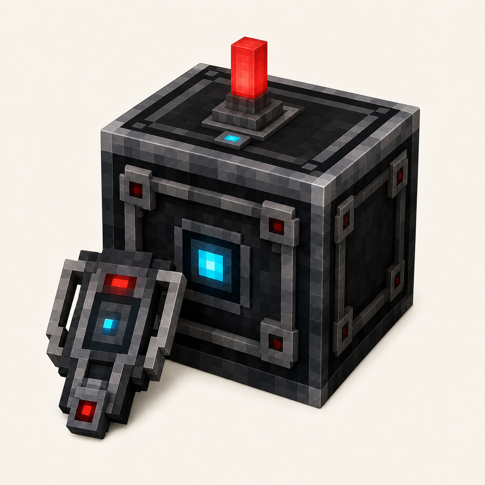

# Simply Light - Smart!



**Simply Light - Smart!** is a NeoForge addon for
[Simply Light](https://www.curseforge.com/minecraft/mc-mods/simply-light) that
adds redstone-dimmable lighting and a wireless-style Smart Switch control
system.

## Features

- Smart versions of Simply Light Bulbs, Illuminant Blocks, Illuminant Slabs,
  Illuminant Panels, and Fixtures in every color.
- Normal dimmers become dimmer as their redstone signal increases; inverted
  dimmers become brighter. Both support the full 0–15 range.
- A Smart Switch relays its exact redstone signal to up to 64 linked dimmers
  within 128 blocks.
- The Smart Linker makes selecting and assigning dimmers quick and visible.

Linked dimmers ignore their local redstone input, and each dimmer can belong to
only one Smart Switch at a time. Existing Simply Light blocks are never
changed.

## Compatibility

- Minecraft 1.21.1
- NeoForge 21.1.234
- [Simply Light 1.5.3+1.21.1-b4](https://www.curseforge.com/minecraft/mc-mods/simply-light)
- Optional [Sable](https://github.com/ryanhcode/sable) 2.0.3 support for
  sublevel-aware linking

The addon does not require Create or Sable to run.

## Shader support

Lights dim and turn off correctly out of the box with
[Solas Shader](https://www.curseforge.com/minecraft/shaders/solas-shader) and
[BSL Shaders](https://www.curseforge.com/minecraft/shaders/bsl-shaders).

For Complementary, the client-side patcher creates an optional `SLSmart`
variant only when it finds an Euphoria Patches-generated shader folder. It
does not alter the base Complementary pack. Select the generated variant in
the shader menu to make the emissive texture follow each light's dimmer level.

Tested patcher combinations:

- Complementary Reimagined or Unbound r5.8.1 with Euphoria Patches 1.9.3
- Complementary Reimagined or Unbound r5.9 with Euphoria Patches 1.10.0

## More information

See the complete [project page](docs/project-page.md) for crafting details,
Smart Linker instructions, compatibility notes, and media.

## Development

```powershell
.\gradlew.bat build
.\gradlew.bat runClient
```

The generated JAR is placed in `build/libs/`.

## License

Distributed under the [MIT License](LICENSE).
